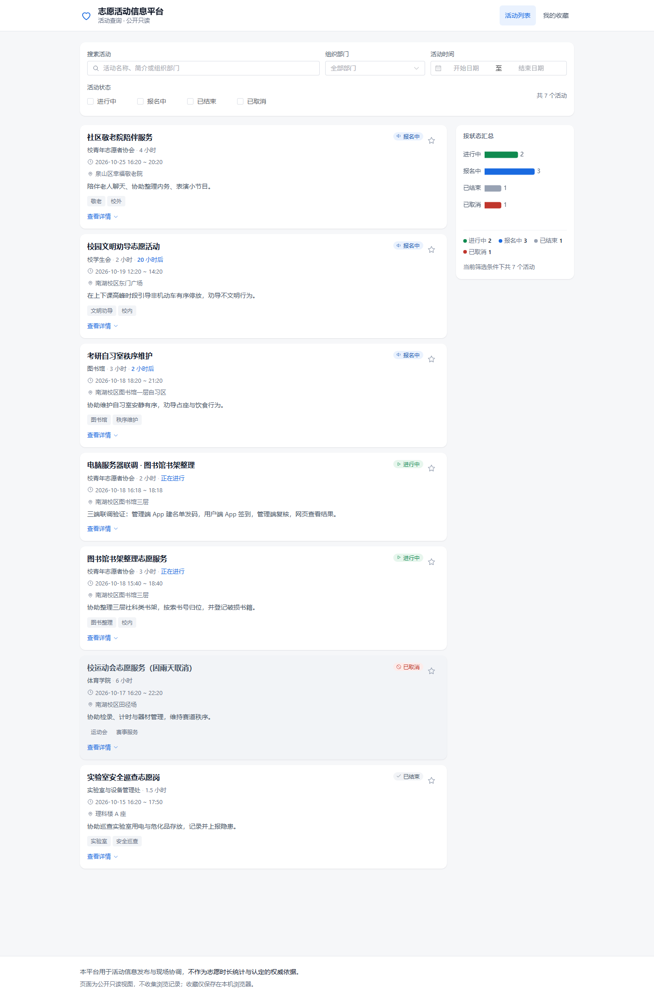
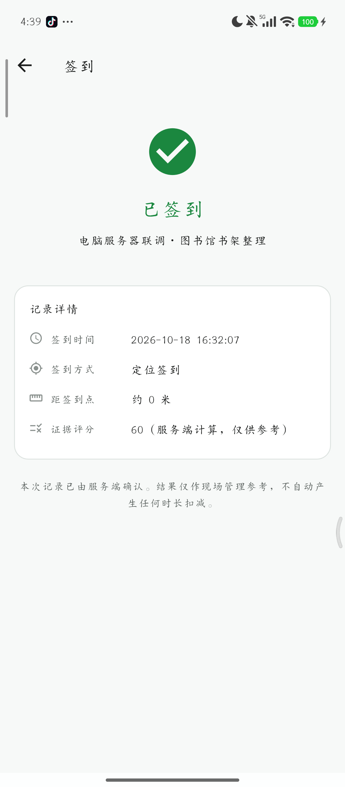
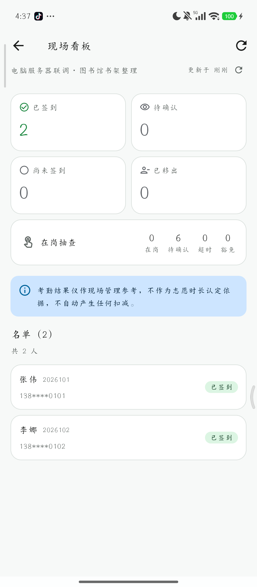

# 志愿活动信息平台

> 一个可以真正跑起来的「活动发布 → 现场签到 → 在岗抽查 → 考勤留痕」完整实现。
>
> **两个 Flutter App + 一个 Vue 网页 + 一个零依赖 Node 服务端**，三端共用同一份接口契约。

<p>


</p>

---

## 这是什么

高校里做志愿活动，"证明我去过"一直是个麻烦事：纸质签到表容易代签，
微信群接龙对不上人，事后统计靠人工。这个项目把整件事做成了一条可追溯的链路：

| 角色 | 用什么 | 做什么 |
|---|---|---|
| **组织者**（发布方） | 管理端 App（Android） | 建活动、导名单、发现场签到、看现场看板、复核证据、导考勤表 |
| **志愿者**（参与者） | 用户端 App（Android） | 输邀请码绑定活动、现场定位签到、响应在岗抽查、查自己的记录 |
| **围观者** | 网页（浏览器） | 只看活动信息，公开可读、无需登录 |

三个端不是拼起来的：**接口契约只有一份**（[`contract/constants.js`](contract/constants.js)），
服务端、两个 App、Mock 全部从它取常量与错误码，改动时一起动。

### 它刻意解决的问题

- **代签**：签到要现场定位 + 网络辅证 + 多次采样一致，综合评分后决定自动通过、转人工还是驳回。
- **"人走了"**：活动进行中随机发「在岗抽查」，几分钟内点一下确认；不响应才算超时。
- **没网**：场地信号差是常态。签到证据先进本机队列，有网自动补传，**补传也带原始时间戳**，事后可分辨。
- **换活动丢记录**：志愿者换活动要重新输邀请码，之前参加过的记录**留在本机**，随时能回看。

---

## 界面预览

**网页端（公开只读）**



**手机端**

| 用户端 · 活动页 | 管理端 · 现场看板 |
|---|---|
|  |  |

更多截图见 [`docs/images/`](docs/images/)（手机端 47 张、网页 4 张，来自真机与真浏览器的联调记录）。

---

## 功能

### 管理端 App

- **工作台**：我发布的活动，按状态分组，一键进入看板
- **建活动**：地图选点 + 用当前网络（自动抓 Wi-Fi BSSID / 校园网段）、签到半径、时间窗、时长
- **名单**：逐个添加 / **从 Excel · CSV 文件导入**（自动识别表头、学号姓名学院手机号，列顺序错位也能对齐）
- **邀请码**：按人一次性发放，点一下就复制「活动编号 + 学号 + 邀请码」整段文字，直接发给本人
- **现场看板**：实时四态（已签到 / 待确认 / 未签到 / 已取消）、在岗抽查统计、点名与手动抽查
- **复核**：看证据评分构成（每条得分与理由），通过或驳回（驳回必须填备注）
- **导出**：活动汇总 / 签到明细 / 名单 / 考勤明细 / 我的记录，CSV 带免责声明首行

### 用户端 App

- **绑定**：输活动编号 + 学号 + 一次性邀请码；支持**粘贴整段邀请信息自动填写**
- **活动页**：我现在该干什么（去签到 / 等抽查 / 已结束），倒计时与签到窗口
- **签到**：一次定位取点（不采集持续轨迹），评分与判定结果当场可见
- **在岗确认**：点一下完成，零输入；显示剩余倒计时
- **我的记录**：签到记录、抽查记录、待上传队列，以及**本机保存的历史参与活动**

### 网页端

公开只读：活动列表（搜索 / 部门 / 时间 / 状态筛选 + 状态分布统计）、活动详情、收藏（存本机浏览器）。

### 服务端

完整 REST 接口 + SQLite（`node:sqlite`，**零运行时依赖**）或 MySQL、增量同步游标、
审计日志、速率限制、导出、数据留存期清理。

---

## 快速开始

### 方式一：只想看看效果（最快，Windows，1 分钟）

1. 从 Releases 下载 `志愿活动平台-服务器整合包.zip`（约 51 MB，内含 Node 运行时与两个 APK）
2. 解压，双击 **`启动服务器.bat`**
3. 第一次会弹一次 UAC（放行防火墙），点「是」
4. 服务起来后**自动打开浏览器**，看到活动列表就成功了
5. 手机装 `web\dist\apk\` 里的两个 APK，管理端邀请码 **`1111`**

> 详细步骤（含手机连不上怎么办）见 [部署说明](tools/deploy/部署说明.md) 与 [手机连接指南](tools/deploy/手机连接指南.md)。

### 方式二：从源码跑

需要 **Node.js ≥ 22.5**（服务端用了内置 `node:sqlite`，因此不装任何依赖也能跑）。

```bash
# 1) 服务端
cp .env.example .env          # 按需改端口/邀请码
cd server
npm start                     # 默认 http://127.0.0.1:8080

# 2) 网页（另开一个终端）
cd web
npm install                   # 或 pnpm install
npm run dev                   # http://127.0.0.1:5173，已配好 /api 代理
```

首次启动会写入 **2 个演示活动**（一个进行中、一个三天后），可以直接点。

### 方式三：构建两个手机 App

需要 Flutter **3.47.x**、JDK 17、Android SDK 35+。

```bash
cd packages/shared_core     && flutter pub get
cd ../shared_ui             && flutter pub get
cd ../shared_platform       && flutter pub get
cd ../../apps/user_app      && flutter pub get && flutter build apk --release
cd ../admin_app             && flutter pub get && flutter build apk --release
```

Windows 上有一键脚本：

```powershell
tools\build-release.cmd http://<你的电脑局域网IP>:8080/api both
```

---

## 技术栈

| 层 | 选型 | 备注 |
|---|---|---|
| 两个 App | Flutter 3.47 / Dart 3.13 | 单代码库 monorepo，共享 3 个包 |
| 网页 | Vue 3 + Vite 6 + Element Plus + ECharts | 只读前端 |
| 服务端 | Node.js 22.5+（原生 `http`、零依赖） | SQLite（`node:sqlite`）/ MySQL 双驱动 |
| 数据 | SQLite 或 MySQL | 单文件即可跑，无需装数据库 |
| 定位 | `geolocator` / Android Fused | 只在点签到那一刻取一次点 |
| 契约 | 单一 `contract/constants.js` | 错误码、状态机、评分权重、分页全在这里 |

---

## 目录结构

```
apps/
  user_app/            用户端 App（Flutter）
  admin_app/           管理端 App（Flutter）
packages/
  shared_core/         领域模型 + 契约常量 + 评分/时间口径（纯 Dart，零 Flutter 依赖）
  shared_ui/           设计系统与通用组件
  shared_platform/     定位、安全存储、设备指纹、连通性、文件导入
server/                同步服务（Node.js，零依赖）
  src/                 路由、鉴权、签到判定、考勤、导出、数据访问
  scripts/             迁移、种子数据、清理演示数据、静态检查
  test/                152 项接口与判定测试
mock_server/           按契约实现的 Mock（172 项回归测试），App 可脱离服务端开发
web/                   Vue 3 只读前端
contract/              三端共用的契约常量（唯一事实来源）
docs/                  设计文档、联调报告、真机测试记录、截图
tools/                 构建、部署、打包脚本
  deploy/              一键启动器（防火墙 + 启动 + 复制手机地址 + 自动打开网页）
deploy/                Nginx 与 MySQL 初始化（容器化部署用）
```

---

## 几个关键设计

**1. 契约只有一份，谁都不许自己写死**
错误码、状态机、评分权重、分页参数都在 `contract/constants.js`。服务端、两个 App、
Mock 都从它取值，测试里有一条专门守「客户端声明的路径必须服务端真的实现了」。

**2. 签到不是"点一下就行"，是给证据打分**
围栏距离、Wi-Fi BSSID、校园网段、多次采样一致性、是否疑似模拟定位，各有权重；
合计 ≥60 自动通过，30–59 转人工，<30 或疑似作弊直接驳回并说明理由。
发布者复核时看到的是**分数怎么来的**，而不是一个结论。

**3. 在岗抽查：自动也行，手动也行**
自动按「开始后 N 分钟一次、之后每 M 分钟」铺满活动；手动则由发布者在看板上点一下才发。
活动取消或结束时，未响应的抽查统一置为**已豁免**（给出原因），不记缺席。

**4. 离线优先**
没网时签到证据进本机队列，联网后自动补传，报文里带**原始采集时间**与 `offlineBackfill` 标记，
服务端会按"补传"来判定，不会当成刚签的。

**5. 隐私与边界**
定位只在点签到那一刻取一次，不做持续轨迹；网页完全公开只读、不收任何数据；
平台只做现场管理参考，**不作为志愿时长认定依据**（导出文件首行即声明）。

---

## 接口

- 统一信封：`{ code, msg, data, trace }`，`code=0` 表示成功，其余为 8 个授权错误码之一
- 时间：ISO 8601 含本地时区偏移，不用 `Z`
- 分页：`page` / `size`，响应含 `total`
- 鉴权：管理端用邀请码换不透明令牌；志愿者用「活动编号 + 学号 + 一次性邀请码」绑定换令牌
- 完整清单与请求响应示例见 [docs/web-server.md](docs/web-server.md)，路径定义见
  [`packages/shared_core/lib/src/contract/api_paths.dart`](packages/shared_core/lib/src/contract/api_paths.dart)

主要资源：`/auth/*`、`/activities`、`/activities/{id}/participants`、`/activities/{id}/checkins`、
`/checkins/{id}:review`、`/attendance/*`、`/activities/{id}/board`、`/export`、`/changes`。

---

## 测试

```
服务端          152 项
Mock 服务端     172 项
shared_core     228 项（含契约路径、评分、时间口径、参与记录）
shared_ui        45 项
shared_platform  58 项
user_app         23 项
admin_app        29 项
─────────────────────
合计            707 项，全部通过
```

另外每个 Dart 包与两个 App 都跑 `flutter analyze --fatal-infos`，零告警。

```bash
cd server && npm test
cd mock_server && node test/smoke.js
cd packages/shared_core && flutter test
# …其余包同理
```

真机联调记录（含踩过的坑与修法）见 [docs/三端联调报告.md](docs/三端联调报告.md) 与
[docs/device-test-report.md](docs/device-test-report.md)。

---

## 文档

| 文档 | 内容 |
|---|---|
| [使用指南](docs/使用指南.md) | 从发布活动到导出考勤，完整操作说明 |
| [使用指南 · 简版](docs/使用指南-简版.md) | 给第一次用的人，5 分钟上手 |
| [部署说明](tools/deploy/部署说明.md) | 把一台 Windows 电脑变成服务器 |
| [手机连接指南](tools/deploy/手机连接指南.md) | 手机怎么连上这台电脑（含校园网隔离的解法） |
| [离线演示说明](docs/offline-demo.md) | 没有服务器时 App 的演示模式 |
| [网页与服务端](docs/web-server.md) | 接口、鉴权、判定、部署（Docker） |
| [设计决策](docs/decisions.md) | 为什么这么做、放弃了哪些方案 |
| [开发记录](docs/development-log.md) | 进度与验收对照（原始 README） |

---

## 常见问题

**没有服务器，能用吗？**
能。App 自带**离线演示模式**（管理端邀请码 `1111`），也可以直接用整合包在本机起一个真正的服务端。

**手机连不上电脑上的服务端？**
最常见的原因是**校园网/路由器的客户端隔离**（同一个 Wi-Fi 但互相不通）。
两种解法：手机开热点让电脑连进来；或者用 USB + `adb reverse tcp:8080 tcp:8080`。
详见 [手机连接指南](tools/deploy/手机连接指南.md)。

**换活动后之前的记录没了？**
不会。换活动需要重新输邀请码，但参加过的记录保存在本机，可在「记录」页底部
或绑定页「我参与过的活动」里回看。

**演示数据能清掉吗？**
能。关掉服务端后执行 `node server/scripts/reset-demo.mjs`，会清空业务数据并重新写入两个演示活动。

---

## 许可证

[MIT](LICENSE)。随便用、随便改，保留版权声明即可。

> **免责声明**：本项目是教学/实践性质的开源实现，用于活动信息发布与现场协调，
> **不作为志愿时长统计与认定的权威依据**。导出文件首行即带此声明。上线使用前请自行
> 完成隐私合规与安全评估（尤其是定位信息与个人信息）。

### 维护者：发布到 GitHub

本仓库已初始化好（`main` 分支、`.gitignore` 已排除凭据与产物）。要发到 GitHub：

```powershell
tools\publish-github.bat          # 双击也行，会问你要 token
```

它做三件事：建仓库（已存在则跳过）→ 推送全部源码 → 把两个 APK 与整合包传到 Release。
token 只在本次命令里用一次，不写进 `.git/config`。

**重复运行是安全的**：已存在的仓库、已推的提交、已上传的附件都会跳过，只补做缺的步骤。
## 贡献

见 [CONTRIBUTING.md](CONTRIBUTING.md)。欢迎提 Issue 与 PR —— 特别是
"在别的机型/浏览器上跑不起来"这类反馈，比新功能更有价值。
